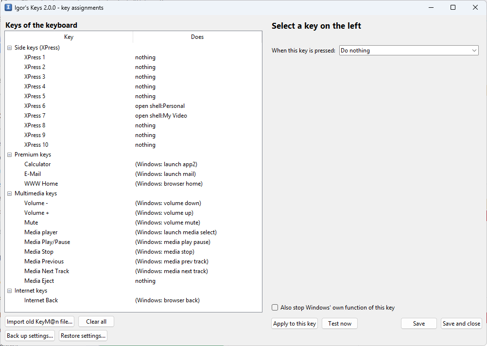

# Igor's Keys

Igor's Keys makes the extra keys of the **CHERRY CyMotion Master XPress** keyboard work on Windows 10 and 11.
It replaces Cherry's old KeyM@n program, which no longer works on current Windows.

> **Unofficial.** Igor's Keys is an independent hobby project. It is not affiliated with, endorsed by or supported
> by Cherry. CHERRY, CyMotion and KeyM@n are trademarks of their respective owners and are used here only to say
> which keyboard and which old program this works with.

## Made for one keyboard

Igor's Keys was written for, and tested on, exactly one keyboard:

| | |
|---|---|
| Keyboard | **CHERRY CyMotion Master XPress**, with five XPress keys down each side of the keyboard |
| Model | **G86-21050** (sold under part numbers such as `G86-21050PLAAAA` and `G86-21050SLAAAA`; the letters after the number differ between versions) |
| Connection | USB + PS/2. **Igor's Keys needs it plugged in by USB.** |
| Seen by Windows as | USB device `046A:0023` |
| Originally supported | Windows 98 SE / ME / 2000 / XP with Cherry's KeyM@n software |

Product listings: [Icecat datasheet (G86-21050PLAAAA)](https://icecat.sg/p/cherry/g86-21050plaaaa/keyboards-cymotion+master+xpress-+g86-21050-779009.html#Specs),
[Melcomp (G86-21050SLAAAA)](https://www.melcomp.hr/CHERRY_G86-21050_SLAAAA_USB_PS2_CyMotion_Master_Xpress_-sreb).

The program only listens to a keyboard with that USB id and ignores every other device. Other keyboards,
including other Cherry models, are not supported.

It is a small program that sits in the notification area (next to the clock) and waits for the extra keys.
When you press one, it does what you told it to: type a text, press a key combination, or open a program,
folder or web page.

## Installing

Download `IgorsKeys-<version>-win64.zip` from the
[Releases page](https://github.com/alpner/igors-keys/releases/latest) and unzip it. (The repository itself
contains only the source code; the ready-made program is attached to each release.)

1. Copy the whole `IgorsKeys` folder somewhere permanent that belongs to you, for example
   `C:\Users\<your name>\IgorsKeys`. Do not move it afterwards.
2. Double-click `IgorsKeys.exe`. A small keycap icon appears next to the clock (click the little arrow
   `^` there if you do not see it).
3. Right-click the keycap icon and tick **Start with Windows**, so it starts every time you log in.

No installation, no administrator rights, no driver. The keyboard works exactly as before for normal typing.

**Windows SmartScreen or your antivirus may warn about it.** The program is not code-signed, it is packed with
PyInstaller, and it watches the keyboard and sends keystrokes – all things that make security tools cautious.
On the blue SmartScreen window click **More info → Run anyway**. If you prefer, build it yourself from this
source code (see the end of this page).

### Upgrading from CherryKeys 1.x

Igor's Keys is the new name of CherryKeys and keeps its settings in a new place, so it starts with the default
assignments. To bring yours along:

1. In CherryKeys, click **Back up settings…** and save the file somewhere.
2. Untick **Start with Windows** in the CherryKeys tray menu, then **Quit** it and delete its folder.
3. Install Igor's Keys as above, then use **Restore settings…** with the file from step 1.

**Slovenščina:** the program switches to Slovenian by itself when Windows is in Slovenian; the tray menu
**Language** overrides that. Slovenian manual: `README.sl.md`.

## Which keys does it handle?

The keyboard has these extra keys:

| Keys | What they do without Igor's Keys | With Igor's Keys |
|---|---|---|
| The 5 keys left of the letters (F1–F5 with icons) and the 5 keys right of them (F6–F10) | nothing at all | whatever you assign |
| Eject | nothing | whatever you assign |
| Volume −/+, Mute, Media player, Play/Pause, Stop, Previous, Next | Windows handles them | still Windows, unless you assign something |
| Calculator, E-mail, Internet/Home, Back, Forward, Stop, Refresh, Search | Windows handles them | still Windows, unless you assign something |

Holding the **KeyM@n** key and pressing one of the ten side keys gives the ordinary F1 … F10 keys. That is built
into the keyboard and works with or without Igor's Keys.

Out of the box only two keys are set: the first key of the right column opens your Documents folder and the
second one opens your Videos folder. Change or remove those as you like.

## Assigning keys



Right-click the keycap icon and choose **Edit key assignments…** (or double-click the icon).

1. Click a key in the list on the left.
2. Choose what should happen:
   * **Type a text** – for example your address or an e-mail signature. Enter in the text makes a new line.
   * **Press a key combination** – click **Record…** and press the combination on the keyboard, pick one from
     the **common action** list (copy, paste, volume, play/pause, show desktop …), or type it, for example
     `Ctrl+C`, `Alt+F4`, `Win+E`, `PageDown` or `Enter`.
   * **Open a program, file, folder or web address** – pick a **common place** (Documents, Downloads, Notepad,
     Google, lock the computer …), use the Browse buttons, or type a web address such as
     `https://www.google.com`. `shell:Personal` means your Documents folder.
   * **Run several steps in a row** – one step per line, for example:
     ```
     keys: Win+R
     wait: 300
     text: notepad
     keys: Enter
     ```
3. Click **Apply to this key**, then **Save**. Igor's Keys picks up the change by itself within a few seconds.

**Test now** tries the action immediately. For texts and key combinations you get two seconds to click into
the window where the keystrokes should go.

For the keys Windows already handles (volume, calculator and so on) there is a box
**Also stop Windows' own function of this key**. Tick it if you give such a key a new job and do not want the
old one to happen as well.

## Bringing over your old KeyM@n settings

In the editor click **Import old KeyM@n file…** and choose your `.csf` file (for example
`CyMotionMasterXPress.csf`). You get a list of what will be imported; the keys that Windows handles by itself
are left alone, and the KeyM@n+key layer is skipped because the keyboard does that on its own.

## Backing up your settings

In the editor (or in the tray menu) click **Back up settings…** and choose where to save the file, for example
`IgorsKeys-settings-2026-10-11.json` on a USB stick. **Restore settings…** loads such a file back and replaces
all assignments. Every time you save, the previous version is also kept automatically in
`C:\Users\<your name>\AppData\Local\IgorsKeys\backups` (the last 20).

## The tray menu

* **Edit key assignments…** – opens the editor.
* **Reload assignments** – re-reads the settings file (normally not needed, it happens automatically).
* **Pause / Resume** – temporarily switch Igor's Keys off without closing it.
* **Start with Windows** – tick to start automatically.
* **Back up settings… / Restore settings…** – save your assignments to a file, or load them back.
* **Open log file** – shows what the program did; send this file when asking for help. It never contains the
  texts your keys type, only how long they are.
* **Open settings folder** – where `config.json` (your assignments) and the log live:
  `C:\Users\<your name>\AppData\Local\IgorsKeys`.
* **Quit** – stops the program until you start it again.

## If something does not work

* No keycap icon? Click the `^` arrow next to the clock. Still nothing: start `IgorsKeys.exe` again; if it is
  already running, the second start simply exits.
* A key does nothing: open the editor and check that the key has an assignment and that Igor's Keys is not paused.
  The log file shows a line like `XPress 3 pressed` every time a side key is pressed, and what happened next.
* The program never crashes on a strange key press; anything unexpected is written to the log and ignored.
* Volume, media and browser keys stop working: untick **Also stop Windows' own function** for those keys.

## For the technically minded

* The keyboard sends its extra keys on a separate USB HID "consumer control" interface. Its report descriptor
  declares a maximum usage of 0x23C, but several keys send larger values, which Windows discards. Igor's Keys
  reads the raw reports with the Raw Input API (`RIDEV_INPUTSINK`) and matches them against `keys.json`. It never
  registers for the normal keyboard interface, so it cannot interfere with typing.
* Settings: `%LOCALAPPDATA%\IgorsKeys\config.json` (plain JSON, documented in `igorskeys/config.py`).
  Log: `%LOCALAPPDATA%\IgorsKeys\igorskeys.log` (rotating, 1 MB × 4).
* Command line: `IgorsKeys.exe --edit` (editor), `IgorsKeys.exe --import file.csf` (import on the command
  line), `IgorsKeys.exe --debug` (verbose log), `IgorsKeys.exe --first-run` (also enables autostart).
* The old KeyM@n `.csf` format is an MFC CArchive serialization with keys stored as PS/2 scan codes;
  `igorskeys/csf.py` documents and parses it and `igorskeys/importer.py` converts it.
* Building from source on a machine with Python 3.11 or newer:
  ```
  cd app
  pip install -r requirements.txt
  powershell -ExecutionPolicy Bypass -File build.ps1
  ```
  The result is `app\dist\IgorsKeys\`. To run without building: `python main.py` (tray) and
  `python main.py --edit` (editor). Discovery notes and the capture tools are in `discovery/FINDINGS.md`.
